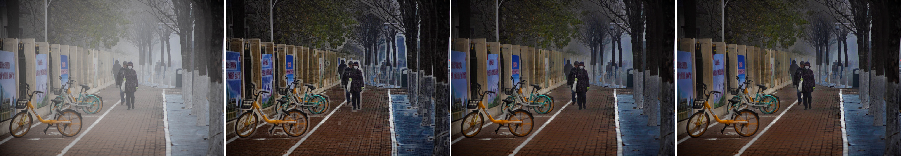

# 暗通道先验去雾：从 Python 到 Zynq-7020 + OV5640

一个完整走通的去雾项目，三段式推进：

1. **纯软件**：`dehaze.py` 是暗通道先验（Dark Channel Prior）的参考实现，
   配 `experiments.py` 做参数研究（引导滤波、ω、patch、t₀ 的影响）；
2. **HLS IP**：同一个算法写成定点流水线（separable 15×15 min filter + 直方图估计
   大气光 + 引导滤波细化透射率），C 仿真与 Python 金模型逐像素比对；
3. **上板**：Zynq-7020 纯 PL 通路 `OV5640 → DVP 采集 → 双时钟行缓存 → DDR ring →
   HLS 去雾 → 浏览器实时预览`，不含 DPU、不含 VDMA，控制面只有一条 AXI-Lite。

| | |
|---|---|
| 器件 | XC7Z020-2CLG400（MZ7X 板） |
| 工具链 | Vivado / Vitis HLS 2019.1，交叉编译 arm-linux-gnueabihf (glibc 2.28) |
| PL 时钟 | FCLK0 = 50 MHz |
| 时序 | WNS **+2.438 ns**，WHS **+0.043 ns**，跨时钟域 0 条负松弛路径 |
| 资源 | LUT 16 221 / 53 200（**30.5 %**）、FF 13 024、BRAM 81.5 / 140（**58 %**）、DSP 74 / 220 |
| 去雾核延迟 | mode 0 **261.9 ms**，mode 1 **415.9 ms**（640×480，50 MHz） |
| 摄像头 | 640×480 RGB565，640 px/行，PCLK ≈ 18.7 MHz，行频 ≈ 3.5 kHz，≈ 7 fps |
| 实时预览 | 浏览器直连板子，原始帧 + 去雾帧并排，≈ 2 fps（核限速） |

---

## 目录结构

```
dehaze.py                     DCP 去雾参考实现（numpy + OpenCV）
experiments.py                参数实验脚本
images/                       测试图片
output/                       实验结果图（README 里引用的那几张）
docs/img/                     本文档用的对比图

fpga/
  00_tools/                   造 LUT、造测试向量、BMP/PNG 转换、校验和、质量分析
  01_hls/                     HLS 工程
    src/dehaze_top.cpp        定点去雾核（约 700 行，注释即设计文档）
    tb/dehaze_tb.cpp          自检 testbench：与 Python 金模型比 PSNR + A
    build.tcl                 csim / csynth / export
  02_vivado/                  Block Design + 实现
    create_bd.tcl             纯脚本建 BD（PS7、smartconnect、protocol converter）
    camera.xdc                摄像头引脚与像素域约束
    build.tcl                 综合→实现→位流→.hdf，带时序闸门
  03_linux/                   板端用户态程序（交叉编译）
    src/dehaze_linux.c        文件→去雾→文件（不需要摄像头即可验证核）
    src/dehaze_cam.c          摄像头→去雾→文件（批处理 + 全链路自检）
    src/dehaze_web.c          摄像头→去雾→浏览器实时预览
    www/                      预览页面 + 调参用的 CGI
  03_baremetal/               裸机版本（需要 JTAG，仅作备用路线）
  04_camera/rtl/              OV5640 DVP 采集、SCCB、行缓存、DDR 行写入
    ov5640_sccb.v             SCCB 主机 + 254 条寄存器表时序器 + 回读
    ov5640_dvp_linebuf.v      DVP 取字节、拼 RGB565、双 bank 行缓存
    camera_pipe.v             双时钟 BRAM + 跨域握手 + 速率计数器
    ddr_line_writer.v         行→AXI4 突发写入 DDR ring
    camera_top.v              XCLK MMCM、SCCB 自动配置、AXI-Lite 状态口
  board_run.ps1               一键上板：抓 U-Boot→起 Linux→加载位流→跑全程→回传图
  README.md / HANDOVER.md / RESUME_HERE.md / SUMMARY.md    详细设计与踩坑记录
```

---

## 效果

板子上跑出来的（左原始帧，右去雾输出，同一帧）：



---

## 第一部分：纯软件参考实现

```bash
pip install numpy opencv-python matplotlib
python dehaze.py            # 单张图：dark channel / t / 去雾结果并排输出
python experiments.py       # 参数研究，图落在 output/experiments/
```

`dehaze.py` 里的流程就是后来硬件的流程，一一对应：

| 软件 | 硬件 |
|---|---|
| `cv2.erode(min_channel, 15×15)` | 可分离 15×15 最小值（16 行行缓存 + 15 抽头） |
| 直方图法取 top 0.1 % 的平均色作为 A | 256 bin 直方图，每 bin 累加各通道和 |
| `t = 1 - ω·dark/A` | Q8 定点，同一公式 |
| `guided_filter(gray, t, r=30, eps=1e-4)` | 两遍 61×61 box filter（列和 + 行滑动窗） |
| `J = (I-A)/max(t,t₀) + A` | 257 项 `1/t` ROM + Q16 乘法 |

`experiments.py` 的四组实验回答"参数该怎么选"：引导滤波的作用、ω（去雾强度）、
patch 尺寸、t₀（暗部保护）。这也是后来把 ω / t₀ / acomp 做成**运行时可调寄存器**
的依据 —— 在板上现场调比重新综合快得多。

---

## 第二部分：Zynq-7020 + OV5640

### 系统结构

```
        OV5640 (DVP 8-bit RGB565)
            │ PCLK / HREF / VSYNC / D[7:0]
            ▼
   ┌───────────────────┐   pclk 域          aclk 域 (50 MHz)
   │ ov5640_dvp_linebuf│──────────────┐
   │  拼字节→32bit 字   │  行 toggle    │
   └───────────────────┘  + 行宽/行号   ▼
                              ┌────────────────────┐
                              │ camera_pipe        │
                              │  双 bank 双时钟 BRAM│
                              └─────────┬──────────┘
                                        │ 整行突发
                                        ▼
                              ┌────────────────────┐        ┌──────────────┐
                              │ ddr_line_writer    │───────►│ DDR ring     │
                              │ AXI4 master (16 拍)│        │ 0x2000_0000  │
                              └────────────────────┘        └──────┬───────┘
                                                                   │ Linux 读 /dev/mem
                                                                   ▼
                                                        ┌────────────────────┐
                                                        │ dehaze_top (HLS)   │
                                                        │  m_axi_gmem0/1/2   │
                                                        └─────────┬──────────┘
                                                                  │
                                        ┌─────────────────────────┴──────────┐
                                        ▼                                    ▼
                                 deque → 文件 (dehaze_cam)           BMP → 浏览器 (dehaze_web)
```

地址划分（软件侧）：

| 区域 | 物理地址 | 用途 |
|---|---|---|
| 去雾核寄存器 | `0x43C0_0000` | ap_ctrl / src / dst / scratch / w / h / ω / t₀ / gain / acomp / mode |
| 摄像头状态 | `0x43C1_0000` | SCCB、行宽、帧数、ring 行号、速率计数器、写手状态、AXI 快照 |
| 去雾输入 | `0x0800_0000` | BGRx，stride = W |
| 去雾输出 | `0x0C00_0000` | BGRx |
| scratch | `0x1000_0000` | 透射率图 + (a,b) 图 |
| 摄像头 ring | `0x2000_0000` | 1024 行 × 2048 字/行（每字 2 个像素） |

### 几个关键设计决定

* **DDR ring 而不是 VDMA**：摄像头一直往 ring 里写，软件随时读最近 480 行，
  两边不需要对齐帧边界。ring 行号在写侧按帧归零，读侧就读 row 0..479。
* **行缓存双 bank + 单 bit toggle 跨域**：多 bit 计数器不过时钟域，只有 toggle 过去；
  行宽、bank 在 toggle 稳定后再采样。
* **AXI 突发 16 拍**：Zynq-7000 的 HP 口是 AXI3，单次突发上限 16 拍。
  一开始按 256 拍发，`AW` 握手成功但 `WREADY` 永远不来（详见下面的踩坑记录）。
* **没有 JTAG 也能调试**：位流走 `fpga_manager`，状态全靠 AXI-Lite 里的一组诊断寄存器
  （行宽、行频、PCLK、写手 FSM、AXI 握手快照），`dehaze_web`/`dehaze_cam` 会把它们打印出来。

### 上板流程

```powershell
# 0) 交叉编译板端程序
cd fpga\03_linux
powershell -ExecutionPolicy Bypass -File build.ps1      # -> dehaze_linux / dehaze_cam / dehaze_web

# 1) 综合到 .hdf（带时序闸门：WNS/WHS < 0 会拒绝出货）
$env:PATH="<Vivado 2019.1>\bin;"+$env:PATH
$env:VIVADO_STAGE='hdf'
cd ..\02_vivado
& vivado -mode batch -source build.tcl

# 2) 起一个 HTTP 服务，把产物给板子 wget
cd ..\www ; python -m http.server 8010        # 单独窗口

# 3) 一键上板（抓 U-Boot → 起 Linux → wget → fpga_manager 加载 → 跑全程 → 回传图）
cd ..
powershell -ExecutionPolicy Bypass -File board_run.ps1 -HttpPort 8010
```

`board_run.ps1` 会打印验收清单，并在 `www\hw_compare.png` 生成"雾图 | 去雾图"并排图。

### 实时网页预览

```powershell
powershell -ExecutionPolicy Bypass -File board_run.ps1 -Live -LiveMode 1
# -> open: http://<板子 IP>:8090/
```

* 左边摄像头原始帧、右边 PL 去雾输出，同一帧并排；
* 顶栏显示刷新 fps、核耗时、大气光 A、模式、分辨率、ring 帧号；
* **4 个滑块 + 3 个预设**：ω / t₀ / gain / acomp，拖动即改板子上的 `params.cfg`，
  下一帧生效 —— 不需要重新综合位流（这是画质调参能快速迭代的关键）；
* 板子端用 24 位 BMP + `busybox httpd`，不需要 libjpeg/libpng。

### HLS 核的寄存器（运行时全部可调）

| 偏移 | 名称 | 说明 |
|---|---|---|
| `0x00` | ap_ctrl | start / done / idle |
| `0x10` | ap_return | 估计出的大气光 A（B,G,R 各 8 bit） |
| `0x18/0x20/0x28` | src / dst / scratch | 物理地址 |
| `0x30/0x38` | width / height | |
| `0x40` | omega_q8 | 去雾强度，Q8（0.69 → 176） |
| `0x48` | t0_q8 | 透射率下限，Q8（0.28 → 72） |
| `0x50` | gain_q8 | 输出增益，Q8（1.09 → 280） |
| `0x58` | acomp_q8 | 大气光彩度保留，Q8（0 = 全灰，256 = 保留估计值） |
| `0x60` | mode | 0 = 只做透射率；1 = 加引导滤波细化 |

---

## 踩过的坑（都是真 bug，记下来省得别人再走一遍）

1. **Vivado 的 XDC 里不能写 Tcl `if`**。写了不会报错，整块约束被**静默跳过** ——
   于是"约束为什么不生效"查了很久。校验逻辑已移到 `build.tcl`。
2. **`set_clock_groups` 在 PS 时钟还没定义时静默失效**，跨时钟域约束等于没写。
   改成基于 cell 的 false path，并在 build 里断言"跨域无负松弛路径"。
3. **HLS 读少一拍**：4 拍写法的块 RAM 读让整行数据错位一个字；
   后来又把 3 拍写法改成 4 拍（`address → data → present → hold`）才对齐。
4. **SCCB 读不能发 repeated START**。OmniVision 的 SCCB 必须在"写寄存器地址"之后发
   **STOP 再 START**；直接 repeated START 时从机根本不驱动 SDA，四个寄存器全读回 `0xFF`。
   加上 STOP 后 chip ID 立刻读回 `0x56`。
5. **AXI3 突发上限 16 拍**：按 256 拍发时，`AW` 被接受、`WREADY` 永远不来，
   写手挂在第一行。诊断靠一个"AXI 握手快照"寄存器（`awvalid/awready/wvalid/wready/bvalid/wphase`）。
6. **行计数器 16 bit 饱和**：`(line_cnt % 480) == 0` 用了一个自增到 `0xFFFF` 就停的计数器，
   流 65535 行（约 3 s）之后 `line_first` 再也不拉高，画面退化成"随便一截 ring 窗口"。
   指纹是 `帧数` 冻结而 `行号` 还在跑。
7. **大气光 A 的单像素估计**：top 0.1 % 里取"最亮的一个像素"的 RGB，
   会落在一个任意色偏的高光上（实测 A=(206,190,198)），
   而 `J_c=(I_c−A_c)/t+A_c` 在 t 低时把 16 级通道差放大成 ~40 级 —— 画面发绿、蓝通道被压死。
   改成 **top band 的平均色 + 可调彩度压缩**后，白色物体的 G−B 从 +4.8 收到 +0.2。
8. **软加载位流的次数限制**：这块板子连续 `fpga_manager` load 6~7 次后必然
   `DMA reported error`，只能断电。所以脚本会先探测 PL 里是不是已经是我们这个设计
   （读自由运行计数器两次，值必须不同），是就跳过加载。

更细的记录见 `fpga/HANDOVER.md`、`fpga/RESUME_HERE.md`、`fpga/04_camera/README.md`。

---

## 已知限制 / 后续可做

* **帧率**：去雾核一帧 177 ms（mode 1），所以实时预览约 2 fps。
  想快只能动核：引导滤波降采样、或把 61×61 窗口改小。
* **画质**：透射率窗口固定（r=30）、不分远近景；没有天空/高光保护；没有 gamma，
  暗部仍偏暗；逐通道除法会放大饱和度（实测 25 % → 37 %），
  想要更"自然"可以加饱和度上限，或改成 luma 引导的单通道 t。
* **传感器配置**：寄存器表是按 640×480 RGB565 调的，换分辨率要重算
  `DVPHO/DVPVO/HTS/VTS` 与 crop 窗口（`04_camera/tools/gen_sccb_table.py`）。
* **没有 JTAG 的调试体验**：状态寄存器已经比较全，但真正"看波形"还是得靠 ILA（需要 JTAG）。

---

## 许可与致谢

* 本仓库代码采用 MIT 许可，见 [LICENSE](LICENSE)。
* OV5640 的寄存器**数值**参考了公开的 OmniVision 数据手册与手边可用的厂商示例工程；
  只取寄存器取值（关于器件的事实），没有复制任何代码。
* Zynq / Vivado / Vitis HLS 是 Xilinx（AMD）的商标，本仓库与 Xilinx 无关。

---

## English summary

A complete dark-channel-prior (DCP) dehazing project, end to end:

* **Software**: a numpy/OpenCV reference implementation (`dehaze.py`) plus a parameter
  study (`experiments.py`) that motivates every runtime knob the hardware exposes.
* **HLS IP**: the same algorithm as a fixed-point pipeline — separable 15×15 min filter,
  256-bin histogram for the atmospheric light, guided-filter refinement of the
  transmission (61×61 box), 257-entry `1/t` ROM, no runtime divider in the hot loops.
  Verified against a Python golden model (PSNR 42.3 dB / 44.5 dB for mode 0 / 1).
* **On the board**: a pure-PL Zynq-7020 path — OV5640 DVP capture → dual-clock line
  buffer → AXI4 writer → a DDR ring buffer → the HLS core → a browser preview served
  straight from the board.

Timing closes with WNS +2.438 ns / WHS +0.043 ns at 50 MHz with zero negative-slack
clock-domain crossings; the design uses 30.5 % of the LUTs, 58 % of the block RAM and
74 DSPs. The dehazing core takes 262 ms (no refinement) / 416 ms (guided filter) for
640×480, so the live view runs at ~2 fps — the core, not the camera, is the bottleneck.

The docs (`fpga/*.md`) also record the eight real bugs found on the way, including a
Vivado XDC block that was silently skipped, SCCB's "no repeated START" rule, the
AXI3 16-beat burst limit on the Zynq HP ports, and the single-pixel atmospheric-light
estimate that made neutral objects turn green.
